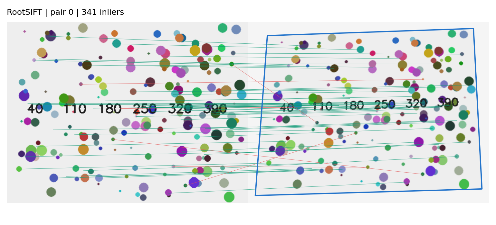
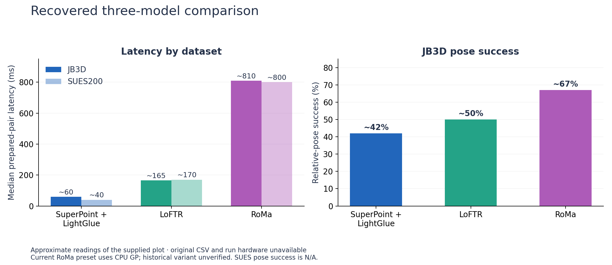
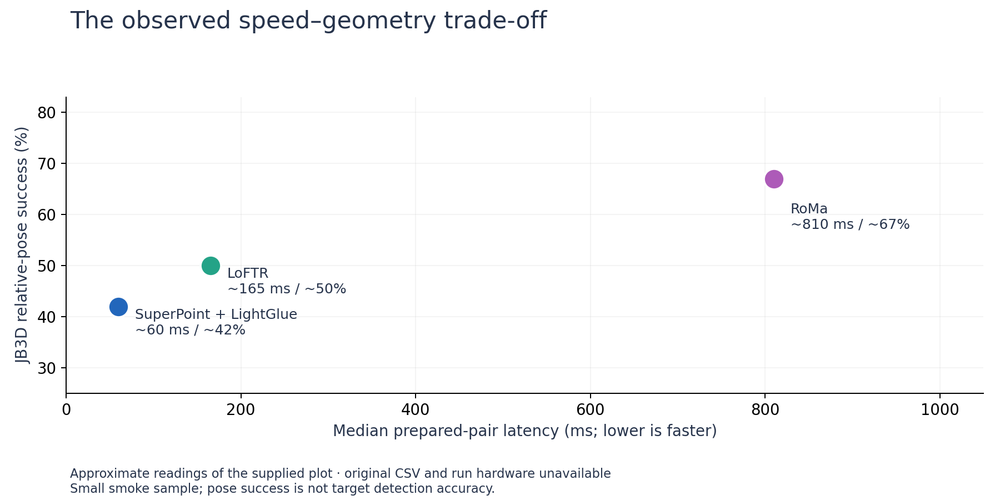
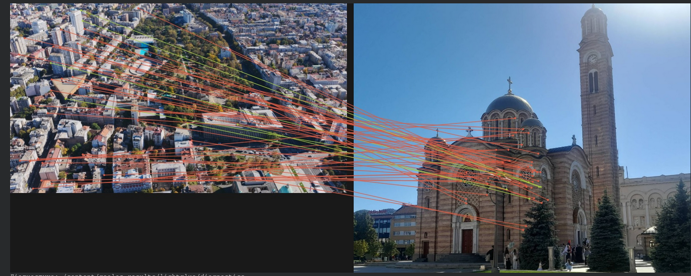
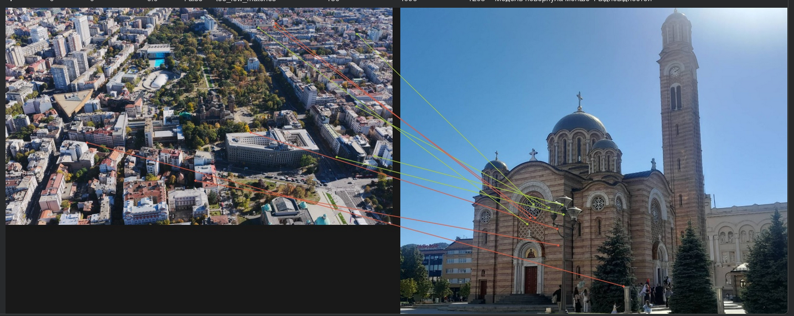
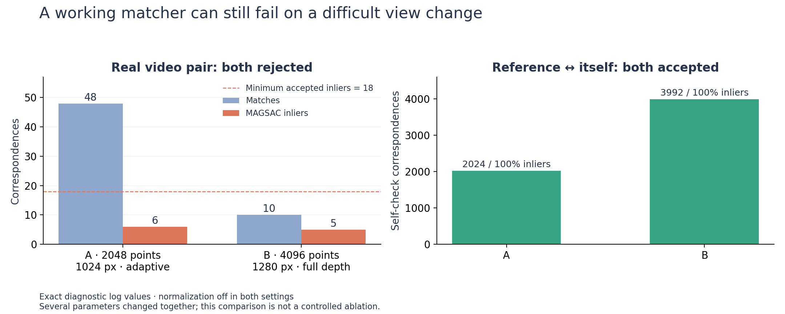

# Image Matching: Comparing Four Methods

Find corresponding points in two images and check whether they agree with a
plausible geometric transformation. Compare **RootSIFT, SuperPoint + LightGlue,
LoFTR and RoMa** using the same image pairs and evaluation code.

## Demo



A synthetic scene and a known perspective warp. Green lines are MAGSAC inliers;
red lines are rejected matches. This example is generated by the notebook and
contains no external images. It checks the implementation on a simple planar
case; it does not demonstrate robustness to difficult real-world viewpoints.

## What I explored

| Method | How it finds correspondences | Role in the comparison |
|---|---|---|
| RootSIFT | Classical keypoints and descriptors, ratio filtering | CPU baseline |
| SuperPoint + LightGlue | Learned keypoints followed by learned matching | Sparse neural approach |
| LoFTR | Detector-free matching between image features | Alternative to sparse keypoints |
| RoMa | Dense correspondences with confidence filtering | Dense neural approach |

All methods use **MAGSAC homography estimation** to reject inconsistent matches.
The comparison records match count, inlier count, spatial coverage and pair
latency. A known homography also enables corner transfer error. Passing the
geometric check does not prove that the images show the same place.

## Earlier experiment results



| Method | JB3D median pair time | SUES-200 median pair time | JB3D pose success |
|---|---:|---:|---:|
| SuperPoint + LightGlue | ≈60 ms | ≈40 ms | ≈42% |
| LoFTR | ≈165 ms | ≈170 ms | ≈50% |
| RoMa | ≈810 ms | ≈800 ms | ≈67% |

These are rounded readings from an earlier experiment plot, stored in
[results.csv](results.csv). Raw pair results, hardware and the exact pose-success
protocol are unavailable. Treat them as exploratory observations. The current
runner does not reproduce this pose benchmark; it evaluates image-pair
homographies. SUES-200 has no pose-success value in the supplied evidence.



The plot suggests a speed/geometry trade-off on this small test; pose success
does not measure target-detection accuracy or deployment FPS. The recovered
figure's CPU GP caption refers to the earlier smoke preset, not the compact
runner's current configuration.

### Conclusions

- LightGlue was the fastest neural method in the earlier comparison.
- RoMa showed higher pose success on JB3D, with substantially greater latency.
- A high match count is not enough: matches may be clustered, repeated or
  inconsistent. Count, coverage and geometry need to be checked together.
- The saved CPU demo exposes a false positive: two different generated scenes
  share printed labels, and their matches pass the geometric gate.
- Missing overlap and strong changes in visible surfaces remain difficult.
- Mild brightness adjustment is available as a separate experiment. Its benefit
  has not been established by the earlier results.

## A difficult match: changing LightGlue settings

A street-level façade reference is compared with an oblique aerial frame.
The views expose different surfaces and repeated patterns, which can leave few
useful correspondences. This is an interpretation of the example.

| Setting A | Setting B |
|---|---|
|  |  |
| 2048 keypoint cap · 1024 px work image · adaptive matching | 4096 keypoint cap · 1280 px work image · adaptive pruning/stopping disabled |

| Diagnostic | A | B |
|---|---:|---:|
| Candidate correspondences | 48 | 10 |
| MAGSAC inliers | 6 | 5 |
| Inlier ratio | 12.5% | 50.0% |
| Identical-reference self-check inliers | 2024 / 2024 | 3992 / 3992 |
| Accepted localization | No | No |
| Rejection reason | Too few inliers | Too few inliers |
| Additional normalization | Off | Off |



Both settings require **18 inliers**, an inlier ratio of **0.20** and a **4 px**
MAGSAC threshold. Setting B's 50% ratio still represents only five inliers.
Increasing the keypoint cap and image size did not solve this example.
Several settings changed together, so this is not a controlled ablation.

These counts come from the earlier diagnostic records and are separate from
the approximate benchmark readings. The self-check shows that extraction and
matching work on an identical image; it does not establish viewpoint robustness.
Colored lines indicate agreement with estimated geometry, not ground-truth
correctness. Screenshot/log pairing was inferred from submission order and the
same scene/frame; a shared run ID was unavailable.

## Run it

Python 3.10+:

```bash
git clone https://github.com/G10BAL/kp-models.git
cd kp-models
python -m venv .venv
# Linux/macOS: source .venv/bin/activate
# Windows: .venv\Scripts\activate
python -m pip install -r requirements.txt
python compare.py --demo --models sift
```

For the explanation, plots and custom-image configuration:

```bash
jupyter lab comparison.ipynb
```

The default uses RootSIFT on CPU. Neural methods require PyTorch; select a CUDA
build for your machine using the [official installer](https://pytorch.org/get-started/locally/).
In Kaggle/Colab, keep the installed PyTorch and enable GPU and Internet. Then
install the dependency for the model you want:

```bash
# SuperPoint + LightGlue
python -m pip install 'lightglue @ git+https://github.com/cvg/LightGlue.git@eb42fee2d71449efb0aa5c10549752b5d75384d8'
# LoFTR
python -m pip install kornia==0.8.2
# RoMa
python -m pip install romatch==0.1.2
```

```bash
python compare.py --demo --models lightglue loftr roma --device cuda
```

Weights download on first use. RoMa is memory intensive and uses its own 560 px
internal coarse resolution; its upsampling is disabled here. A CUDA failure
requires a fresh process/kernel before retrying.

### Your own images

Set `USE_DEMO = False` and edit `PAIRS` in the notebook, or save a JSON list:

```json
[
  {"reference": "data/reference.jpg", "query": "data/query.jpg"}
]
```

```bash
python compare.py --pairs pairs.json --models sift lightglue --output runs-custom
# Optional separate brightness experiment:
python compare.py --pairs pairs.json --models loftr --normalize --output runs-normalized
```

The whole reference image is matched. Optional `H` is a 3×3 ground-truth
homography from original reference pixels to original query pixels. Without
ground truth, corner error stays empty; inlier ratio is not reported as accuracy.

## Evaluation settings

Images are resized to a maximum long side of 640 px. Neural confidence threshold
is 0.2 for LoFTR/RoMa; LightGlue uses its default 0.1. RootSIFT uses a 0.8 ratio
test. The geometric gate requires 18 inliers, a 0.20 inlier ratio, 0.005 coverage
in both images and a plausible projected outline; MAGSAC threshold is 3 px.

Each model is loaded once. One warm-up is excluded, then each pair is measured
three times. `pair_ms` includes both feature extractions, matching and geometry,
with CUDA synchronization. It excludes loading, image I/O, preprocessing,
ground-truth scoring and plotting. It is not end-to-end video FPS. Model settings,
package versions and GPU information are saved with each run. Input failures are
retained in the CSV; missing dependencies or model/CUDA errors stop the run.

<details>
<summary><strong>Historical experiment settings, normalization and timing</strong></summary>

### Historical experiment settings

These presets describe the earlier research workflows that supplied the
figures. They are retained as experimental context; the compact runner has
image-pair matching rather than an own-video tracking workflow.

| Parameter | Three-model smoke benchmark | Own-video notebook |
|---|---|---|
| Prepared image long side | 640 px | 1024 px LightGlue; 640 px LoFTR/RoMa |
| Reference long side | 640 px | 1600 px LightGlue; 800 px LoFTR/RoMa |
| SuperPoint keypoint cap | 2048 | 2048 |
| LightGlue | Adaptive; filter 0.10 | Adaptive; filter 0.10; optional rotation search |
| LoFTR / RoMa score threshold | 0.20 | 0.20 |
| RoMa sampled correspondences | Up to 2000 | Up to 2000 |
| RoMa upsampling / GP device | Off / CPU | On / CPU |
| MAGSAC reprojection threshold | 3 px | 4 px |
| Acceptance | ≥18 inliers; ratio ≥0.20; coverage ≥0.005; projected-shape checks | ≥18 inliers; ratio ≥0.20; footprint checks |
| Additional adaptive normalization | Disabled | Disabled unless `*_norm` selected |
| Timing setup | One warm-up; GPU synchronization; one subprocess per model | Whole workflow with tracking and export |

RoMa uses its own internal network resolution: preparing an input at 640 px does
not make the networks compute at identical resolutions. CPU GP and disabled
upsampling define a particular RoMa variant and must accompany its timing.
These are documented presets; the actual historical plot's hardware and complete
execution settings cannot be reconstructed.

**Current compact runner:** both images use a maximum long side of 640 px;
RoMa uses its 560 px internal coarse resolution, upsampling off and GP on the
model device. Models run sequentially in one process. Its `pair_ms` includes
both images' feature extraction. It therefore has different timing boundaries
from the earlier cached-reference benchmark.

### Historical moderate normalization

The earlier correction uses LAB luminance with strength **0.45**, gamma
**0.8–1.25**, gain **0.85–1.25** and conditional CLAHE blending **≤0.35**.
The luminance change before rounding is bounded to **±10.8** levels at the
default strength; integer rounding can produce an 11-level change.

A shared reference/video profile guides the correction, with smoothed video
statistics. Flat images and already suitable profiles are skipped. This cannot
recover missing overlap, remove parallax or make a hidden façade visible.
The bound applies to LAB L, not to every RGB-channel difference.

This photometric correction is distinct from a model's required tensor
normalization. Earlier RootSIFT preprocessing also applied CLAHE.
The compact `normalize_pair` is a simpler bounded shared-median luminance
adjustment; it does not implement the earlier gamma/gain/CLAHE pipeline.
Its RootSIFT baseline uses grayscale without built-in CLAHE. Current defaults
are described under [Evaluation settings](#evaluation-settings).

### Metrics and real-time interpretation

| Metric | Required evidence | Interpretation |
|---|---|---|
| Matches, inliers, coverage | Predicted correspondences and fitted geometry | Internal diagnostics; not accuracy |
| Epipolar consistency / relative pose | JB3D's SfM-derived camera geometry | Estimated geometry, not independent GPS/IMU truth |
| Scene precision, recall, F1 and acceptance accuracy | SUES scene identities and positive/negative pairs | Same-scene recognition, not target localization |
| Localization IoU | Independently annotated visible-target polygons | Measures the predicted target footprint |
| First hitting time | Target localization labels and independent visibility onset | First correctly localized tested frame after visibility begins |

JB3D supports epipolar and relative-pose evaluation. The earlier evaluator used
5° rotation and 10° translation-direction thresholds for eligible pose pairs;
the exact protocol behind the supplied plot is unverified.
SUES supplies scene identities, so its pose-success value remains **N/A**.
Without target polygons and visibility times, IoU and **first hitting time**
remain missing. A first raw match is not a correctly localized hit.

| Timer | Includes | Excludes |
|---|---|---|
| Historical `pipeline_ms` | Reading the prepared query; query feature extraction; matching; homography checks; CUDA synchronization | Reference preparation, model loading, source-video decoding, dataset preparation, ground-truth scoring, plotting and export |
| Current `pair_ms` | Feature extraction from both prepared images; matching; homography checks; CUDA synchronization | Image I/O, resizing, optional correction, model loading, ground-truth scoring and plotting |

Historical reference preparation and model loading were recorded separately.
Pairs per second are computed from **mean** measured pair latency, not by taking
the reciprocal of a median. Neither timer establishes end-to-end video FPS.

The earlier own-video workflow could track between matching calls and labeled
outputs `match`, `track` and `lost`. A tracking prediction is not a new
successful match. Exporting a full video, or selecting 5 frames per second,
does not demonstrate real-time processing. This compact repository does not
include that tracking workflow.

</details>

## Files

| File | Purpose |
|---|---|
| [comparison.ipynb](comparison.ipynb) | Walkthrough, demo, experiments and plots |
| [matching.py](matching.py) | The four model adapters |
| [compare.py](compare.py) | Preprocessing, geometry, timing, plots and CLI |
| [results.csv](results.csv) | Approximate earlier results and provenance |
| `assets/` | Generated demo, historical comparison figures and LightGlue match screenshots |
| [test_compare.py](test_compare.py) | Offline geometry and CPU integration checks |
| [requirements.txt](requirements.txt) | Base dependencies |

New runs produce `metrics.csv`, `run.json` and match images in `runs/`.

```bash
python -m pip install pytest
python -m pytest test_compare.py -q
```

## Sources

[SuperPoint + LightGlue](https://github.com/cvg/LightGlue) ·
[LoFTR](https://zju3dv.github.io/loftr/) / [Kornia](https://github.com/kornia/kornia) ·
[RoMa](https://github.com/Parskatt/RoMa) ·
[OpenCV homography](https://docs.opencv.org/4.x/d9/dab/tutorial_homography.html).
Earlier dataset labels: [JB3D](https://zenodo.org/records/22787920) and
[SUES-200](https://github.com/Reza-Zhu/SUES-200-Benchmark).

Project code uses [Apache 2.0](LICENSE). Model weights, libraries and datasets
retain their upstream terms, including the separate SuperPoint terms. No model
weights or dataset archives are included. Historical screenshots retain the
underlying imagery's original terms; the synthetic demo is generated here.
