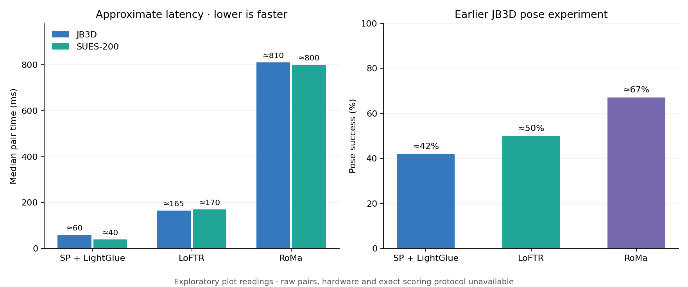

# Image Matching: Comparing Four Methods

Find corresponding points in two images and check whether they agree with a
plausible geometric transformation. Compare **RootSIFT, SuperPoint + LightGlue,
LoFTR and RoMa** using the same image pairs and evaluation code.

## Demo


A synthetic scene and a known perspective warp. Green lines are MAGSAC inliers;
red lines are rejected matches. This example is generated by the notebook and
contains no external images. It checks the implementation on a simple planar
case; it does not demonstrate robustness to difficult real-world viewpoints.

## What I explored

| Method | How it finds correspondences | Role in the comparison |
|---|---|---|
| RootSIFT | Classical keypoints and descriptors, ratio filtering | CPU baseline |
| SuperPoint + LightGlue | Learned keypoints followed by learned matching | Sparse neural approach |
| LoFTR | Detector-free matching between image features | Alternative to sparse keypoints |
| RoMa | Dense correspondences with confidence filtering | Dense neural approach |

All methods use **MAGSAC homography estimation** to reject inconsistent matches.
The comparison records match count, inlier count, spatial coverage and pair
latency. A known homography also enables corner transfer error. Passing the
geometric check does not prove that the images show the same place.

## Earlier experiment results



| Method | JB3D median pair time | SUES-200 median pair time | JB3D pose success |
|---|---:|---:|---:|
| SuperPoint + LightGlue | ≈60 ms | ≈40 ms | ≈42% |
| LoFTR | ≈165 ms | ≈170 ms | ≈50% |
| RoMa | ≈810 ms | ≈800 ms | ≈67% |

These are rounded readings from an earlier experiment plot, stored in
[results.csv](results.csv). Raw pair results, hardware and the exact pose-success
protocol are unavailable. Treat them as exploratory observations. The current
runner does not reproduce this pose benchmark; it evaluates image-pair
homographies. SUES-200 has no pose-success value in the supplied evidence.

### Conclusions

- LightGlue was the fastest neural method in the earlier comparison.
- RoMa showed higher pose success on JB3D, with substantially greater latency.
- A high match count is not enough: matches may be clustered, repeated or
  inconsistent. Count, coverage and geometry need to be checked together.
- The saved CPU demo exposes a false positive: two different generated scenes
  share printed labels, and their matches pass the geometric gate.
- Missing overlap and strong changes in visible surfaces remain difficult.
- Mild brightness adjustment is available as a separate experiment. Its benefit
  has not been established by the earlier results.

## Run it

Python 3.10+:

```bash
git clone https://github.com/G10BAL/kp-models.git
cd kp-models
python -m venv .venv
# Linux/macOS: source .venv/bin/activate
# Windows: .venv\Scripts\activate
python -m pip install -r requirements.txt
python compare.py --demo --models sift
```

For the explanation, plots and custom-image configuration:

```bash
jupyter lab comparison.ipynb
```

The default uses RootSIFT on CPU. Neural methods require PyTorch; select a CUDA
build for your machine using the [official installer](https://pytorch.org/get-started/locally/).
In Kaggle/Colab, keep the installed PyTorch and enable GPU and Internet. Then
install the dependency for the model you want:

```bash
# SuperPoint + LightGlue
python -m pip install 'lightglue @ git+https://github.com/cvg/LightGlue.git@eb42fee2d71449efb0aa5c10549752b5d75384d8'
# LoFTR
python -m pip install kornia==0.8.2
# RoMa
python -m pip install romatch==0.1.2
```

```bash
python compare.py --demo --models lightglue loftr roma --device cuda
```

Weights download on first use. RoMa is memory intensive and uses its own 560 px
internal coarse resolution; its upsampling is disabled here. A CUDA failure
requires a fresh process/kernel before retrying.

### Your own images

Set `USE_DEMO = False` and edit `PAIRS` in the notebook, or save a JSON list:

```json
[
  {"reference": "data/reference.jpg", "query": "data/query.jpg"}
]
```

```bash
python compare.py --pairs pairs.json --models sift lightglue --output runs-custom
# Optional separate brightness experiment:
python compare.py --pairs pairs.json --models loftr --normalize --output runs-normalized
```

The whole reference image is matched. Optional `H` is a 3×3 ground-truth
homography from original reference pixels to original query pixels. Without
ground truth, corner error stays empty; inlier ratio is not reported as accuracy.

## Evaluation settings

Images are resized to a maximum long side of 640 px. Neural confidence threshold
is 0.2 for LoFTR/RoMa; LightGlue uses its default 0.1. RootSIFT uses a 0.8 ratio
test. The geometric gate requires 18 inliers, a 0.20 inlier ratio, 0.005 coverage
in both images and a plausible projected outline; MAGSAC threshold is 3 px.

Each model is loaded once. One warm-up is excluded, then each pair is measured
three times. `pair_ms` includes both feature extractions, matching and geometry,
with CUDA synchronization. It excludes loading, image I/O, preprocessing,
ground-truth scoring and plotting. It is not end-to-end video FPS. Model settings,
package versions and GPU information are saved with each run. Input failures are
retained in the CSV; missing dependencies or model/CUDA errors stop the run.

## Files

| File | Purpose |
|---|---|
| [comparison.ipynb](comparison.ipynb) | Walkthrough, demo, experiments and plots |
| [matching.py](matching.py) | The four model adapters |
| [compare.py](compare.py) | Preprocessing, geometry, timing, plots and CLI |
| [results.csv](results.csv) | Approximate earlier results and provenance |
| `assets/` | Two figures used above |
| [test_compare.py](test_compare.py) | Offline geometry and CPU integration checks |
| [requirements.txt](requirements.txt) | Base dependencies |

New runs produce `metrics.csv`, `run.json` and match images in `runs/`.

```bash
python -m pip install pytest
python -m pytest test_compare.py -q
```

## Sources

[SuperPoint + LightGlue](https://github.com/cvg/LightGlue) ·
[LoFTR](https://zju3dv.github.io/loftr/) / [Kornia](https://github.com/kornia/kornia) ·
[RoMa](https://github.com/Parskatt/RoMa) ·
[OpenCV homography](https://docs.opencv.org/4.x/d9/dab/tutorial_homography.html).
Earlier dataset labels: [JB3D](https://zenodo.org/records/22787920) and
[SUES-200](https://github.com/Reza-Zhu/SUES-200-Benchmark).

Project code uses [Apache 2.0](LICENSE). Model weights, libraries and datasets
retain their upstream terms, including the separate SuperPoint terms. No model
weights or dataset images are included. The generated demo is deliberately simple.
